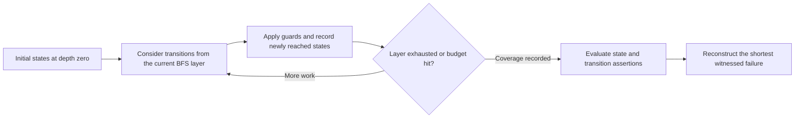

# Mathematical validation

For a validated model the guard relation is fixed by the typed facts at each source state. Thus `F(X) = I ∪ Post(X)` is monotone on the finite powerset lattice. Starting from the empty set, iterating `F` reaches its least fixed point. Production processes each newly discovered BFS layer once. It records each discovered state's predecessor and separately evaluates enabled transitions that return to previously seen states. [Formal derivation](verification.md)

## Independent checks

`tests/reference.php` uses two reference computations. Complete scans over the enabled relation derive the monotone closure. Synchronous relaxation over the full edge set derives minimum distances. Neither procedure uses the production frontier, predecessor reconstruction or Boolean evaluator. Expected predicates in the generated corpus are evaluated separately using native truth values.

The suite makes 1,602 production-to-reference comparisons with seed `20261122`. It checks the reachable set, exact depths, and counterexample lengths under complete exploration. For each witness it checks that the initial state, contiguous edges, guards, and failed predicate agree with the generated graph. Under state, depth and transition limits it also verifies that a complete result still matches the full reference and that every retained witness has minimum length.

The metamorphic tests rename states, reverse edge and initial-state order, add a disconnected unsafe state with a self-loop, and duplicate transitions. Reachability, verdicts and minimum lengths remain equivalent for exhaustive runs. Deterministic tie-breaking follows the model order, so the selected witness can change when several witnesses have equal length. Boolean checks cover truth tables, De Morgan's laws, typed comparisons, pre/post facts and malformed expressions.

The path reconstruction audit found that an absent predecessor could be treated as an initial state and that a cyclic predecessor chain could fail to terminate. The library now validates each link and bounds traversal by the number of known states. The reference suite exercises missing, misdirected and cyclic chains.

## Interpreting conclusions

An exhaustive reachable-state invariant holds over all states reachable from the declared initial set. An inductive proof over a specified transition system separately requires the base case and preservation for every relevant state satisfying its premise, including unreachable states when they are in that specified domain. Dashboard preservation evidence covers explored edges. A budget-limited analysis without a witness produces `INCOMPLETE`. A genuine witness remains `VIOLATED` even when coverage is incomplete. Input validation failures produce `ERROR`.
